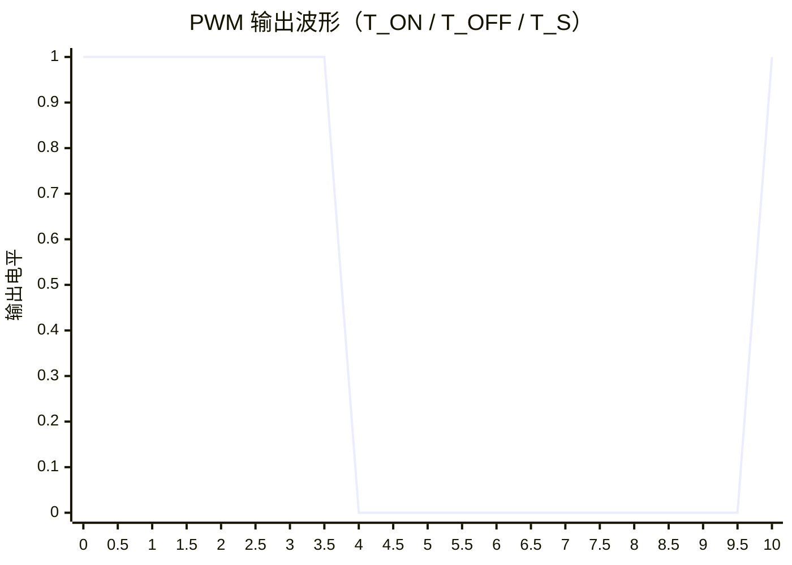

# STM32

---
## OC

---
### OC（输出比较）
- 工作原理：比较CNT与CCR寄存器的值，高精度控制GPIO
- 每个高级定时器/通用定时器有4个OC通道
- 有四个OC比较单元
### OC模式

| 模式       | 描述                                                                                     |
| -------- | -------------------------------------------------------------------------------------- |
| 冻结       | CNT=CCR时，REF保持为原状态                                                                     |
| 匹配时置有效电平 | CNT=CCR时，REF置有效电平                                                                      |
| 匹配时置无效电平 | CNT=CCR时，REF置无效电平                                                                      |
| 匹配时电平翻转  | CNT=CCR时，REF电平翻转                                                                       |
| 强制为无效电平  | CNT与CCR无效，REF强制为无效电平                                                                   |
| 强制为有效电平  | CNT与CCR无效，REF强制为有效电平                                                                   |
| PWM模式1   | 向上计数: CNT<CCR时，REF置有效电平，CNT≥CCR时，REF置无效电平<br>向下计数: CNT>CCR时，REF置无效电平，CNT≤CCR时，REF置有效电平 |
| PWM模式2   | 向上计数: CNT<CCR时，REF置无效电平，CNT≥CCR时，REF置有效电平<br>向下计数: CNT>CCR时，REF置有效电平，CNT≤CCR时，REF置无效电平 |
1. CCR（比对值）
	- 每个TIM有多个CCR寄存器，寄存器最大存储值为65535
	- CCR寄存器与CH通道一一对应
	- CNT与CCR比较，根据模式做出对应行为，有效电平为1，无效电平为0
	- 触发时机计算：CCR/CK_CNT
	- 占空比的计算：CCR/AAR
2. CNT（计数器）
	- 计数器与CCR比较，达到预定数值实现中断
---
### PWM
- 频率：1/T
	- CK_PSC/(PSC+1)/(ARR+1)
- 占空比：Ton/T
	- CCR/(ARR+1)
	- 占空比越大的部分，模拟信号越靠近那一部分
	


> T_ON：一个周期内的高电平时间 ｜ T_OFF：低电平时间 ｜ T_S = T_ON + T_OFF，即一个 PWM 周期（频率 = 1/T_S）

- 分辨率：占空比变化步长
	- 1/(ARR+1)
- PWM配置步骤：
    1. 启动内部时钟
    2. 配置时基单元
    3. 配置输出比较
    4. 配置GPIO
- PWM配置代码：
```c
//开启RCC时钟
RCC_APB1PeriphClockCmd(RCC_APB1Periph_TIM2, ENABLE);

// GPIO配置
RCC_APB2PeriphClockCmd(RCC_APB2Periph_GPIOA, ENABLE);

GPIO_InitTypeDef GPIO_InitStructure;
GPIO_InitStructure.GPIO_Mode = GPIO_Mode_AF_PP;  // 复用推挽输出
GPIO_InitStructure.GPIO_Pin = GPIO_Pin_0;        // TIM2_CH1
GPIO_InitStructure.GPIO_Speed = GPIO_Speed_50MHz;
GPIO_Init(GPIOA, &GPIO_InitStructure);

// 开启内部时钟（可以不写，因为默认开启内部时钟）
TIM_InternalClockConfig(TIM2);

// 配置TIM
TIM_TimeBaseInitTypeDef TIM_TimeBaseInitStructure;
TIM_TimeBaseInitStructure.TIM_ClockDivision = TIM_CKD_DIV1;    // 分频模式
TIM_TimeBaseInitStructure.TIM_CounterMode = TIM_CounterMode_Up;// 向上计数
TIM_TimeBaseInitStructure.TIM_Period = 10000 - 1;              // 目标值
TIM_TimeBaseInitStructure.TIM_Prescaler = 7200 - 1;            // PSC
TIM_TimeBaseInitStructure.TIM_RepetitionCounter = 0;           // 高级计数

// 初始化TIM
TIM_TimeBaseInit(TIM2, &TIM_TimeBaseInitStructure);

// 配置OC
TIM_OCInitTypeDef TIM_OCInitStructure;
TIM_OCStructInit(&TIM_OCInitStructure);

// 配置OC模式
TIM_OCInitStructure.TIM_OCMode = TIM_OCMode_PWM1;
// 配置极性
TIM_OCInitStructure.TIM_OCPolarity = TIM_OCPolarity_High;
// 使能OC
TIM_OCInitStructure.TIM_OutputState = TIM_OutputState_Enable;
// 配置CCR
TIM_OCInitStructure.TIM_Pulse = 500;  // CCR (占空比50%)
// 初始化OC
TIM_OC1Init(TIM2, &TIM_OCInitStructure);

// 使能TIM
TIM_Cmd(TIM2, ENABLE);
```
---
